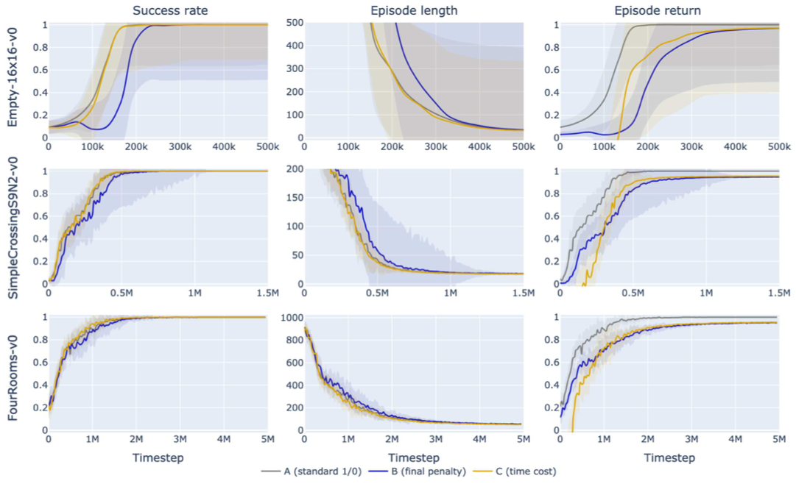
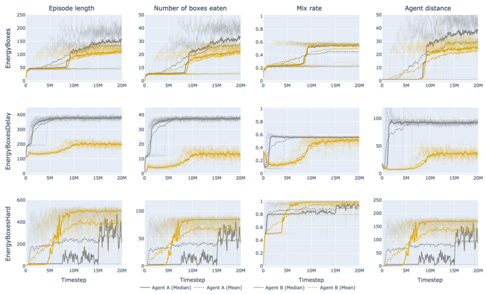

# The impact of time
### Lifetime as governing reward in reinforcement learning

**Can an agent learn useful behaviour simply by being rewarded for staying alive?**

MSc research exploring time as both a reward-shaping signal and an alternative to explicit task rewards, using PPO, MiniGrid and custom survival environments.

**Arnau Quindós** · MSc Data Science and Machine Learning · **University College London, 2023**<br>
Supervised by **Dr Laura Toni** and **Eduardo Pignatelli**

[**Read the dissertation ↗**](MSc_project.pdf) · [Results](#selected-results) · [Install guide](#install-guide) · [Experiments](#experiments) · [Contact](#contact)


[](LICENSE)

## Abstract

Reward design often requires detailed, task-specific knowledge. This project investigates whether an agent's lifetime can provide a more general learning signal through two complementary approaches:

- **Time as reward shaping:** add a per-step cost to a conventional goal reward and compare it with binary rewards and a terminal time penalty.
- **Lifetime as the reward:** give a fixed positive reward for each timestep the agent survives, without an explicit reward for completing the task. This relies on the environment's termination dynamics linking useful behaviour to survival.

Experiments show that lifetime-based agents can approach, and in some settings exceed, the learning speed and final performance of goal-reward baselines. They also expose a central challenge: when actions affect survival only much later, credit assignment becomes difficult. The findings are limited to PPO and grid-world environments; broader generalisation remains an open research question.

## Selected results

### 1. Time as a reward-shaping signal

Three reward designs are compared on MiniGrid navigation tasks: **A**, a binary goal reward; **B**, a goal reward with a terminal time penalty; and **C**, a goal reward with a per-step time cost.

[](docs/images/time-cost-reward-shaping.png)

*Dissertation, Figure 4.4. Lines show medians; shaded regions show standard deviations across runs. Episode returns use different reward definitions and are not directly comparable across all agents.*

**Finding:** the binary reward and per-step time cost produce similar learning curves and final policies in these navigation tasks. A more elaborate reward does not necessarily improve learning; the terminal-penalty baseline generally learns more slowly.

### 2. Learning to survive without an explicit goal reward

In the custom **EnergyBoxes** environments, moving and eating replenish or consume an agent's energy budget. Depleting that budget ends the episode. The comparison is between **Agent A**, rewarded for eating a food box, and **Agent B**, rewarded only for each timestep it stays alive.

<p align="center">
  
  <br>
  <em>The EnergyBoxes grid, reproduced from Figure 5.1 of the dissertation.</em>
</p>

[](docs/images/lifetime-reward-results.png)

*Dissertation, Figure 5.2. Grey denotes goal rewards; gold denotes lifetime rewards. Faint lines show individual runs, solid lines the median, and dotted lines the mean.*

| Environment | Main observation |
| --- | --- |
| **EnergyBoxes** | Both agents learn at a similar rate; goal rewards produce longer final survival times. |
| **EnergyBoxesDelay** | Goal rewards learn faster and achieve better performance when the survival benefits of eating are delayed. |
| **EnergyBoxesHard** | Lifetime rewards improve learning speed, stability and final performance in the tightly constrained survival setting. |

The [dissertation](MSc_project.pdf) includes additional environments, an analysis of the GAE parameter λ, and behavioural comparisons explaining the delayed-reward failure case. Figures above are reproduced from the original report; click either result plot to view it at full size.

## Prerequisites

- **Conda** (Anaconda or Miniconda) and **Python 3.10**.
- A CPU is sufficient to run training; CUDA is optional.
- Weights & Biases is optional for experiment tracking. The examples below disable remote logging.

## Install guide

Clone the repository and create an environment for the original research code:

```bash
git clone https://github.com/nauqs/msc-project.git
cd msc-project
conda create --name minigrid python=3.10
conda activate minigrid
```

Install the core dependencies:

```bash
python -m pip install "numpy<2" torch==2.0.1 gymnasium==0.28.1 minigrid==2.2.1 matplotlib==3.7.1 wandb==0.15.4 imageio==2.31.1
```

These versions reflect the original research stack. The root `environment.yml` is an early scaffold; use the setup above for the MiniGrid experiments.

## Experiments

Run the following commands from the **`minigrid/` directory**:

```bash
cd minigrid
```

### Train a single agent

Start with a standard MiniGrid navigation task:

```bash
python train.py \
  --env-id MiniGrid-Empty-6x6-v0 \
  --exp-name navigation-baseline \
  --seed 1 \
  --total-timesteps 1000000 \
  --wandb false
```

To explore lifetime as the sole reward, train in EnergyBoxes with a positive time bonus and no food-box reward:

```bash
python train.py \
  --env-id EnergyBoxes \
  --exp-name lifetime-agent \
  --time-bonus 0.1 \
  --box-reward 0 \
  --total-timesteps 20000000 \
  --num-steps 512 \
  --ent-coef 0.02 \
  --seed 1 \
  --wandb false
```

This uses the lifetime-reward configuration in [`exp-2.csv`](minigrid/experiments/exp-2.csv). For the goal-reward baseline, use `--time-bonus 0 --box-reward 1` and a different experiment name.

<details>
<summary><strong>Key training options and defaults</strong></summary>

| Option | Default | Purpose |
| --- | --- | --- |
| `--env-id` | `MiniGrid-Empty-6x6-v0` | Environment to train in. |
| `--seed` | `1` | Random seed. |
| `--total-timesteps` | `1000000` | Total environment steps. |
| `--num-envs` | `32` | Parallel environments. |
| `--num-steps` | `256` | Steps per environment in each rollout. |
| `--time-cost` | `0` | Per-step cost for the time-cost wrapper. |
| `--time-bonus` | `0` | Per-step survival reward in EnergyBoxes. |
| `--box-reward` | `1` | Reward for eating a box in EnergyBoxes. |
| `--verbose` | `True` | Print training metrics. |
| `--wandb` | `True` | Enable Weights & Biases logging. |
| `--wandb-project` | `experiments-test` | Tracking project name. |

Run `python train.py --help` for all options. To enable remote logging, configure the `entity` in `train.py` for your W&B account; the original code uses `nauqs`.

</details>

### Inspect a trained agent

Training saves checkpoints to `trained-models/<env-id>/actor_<exp-name>.pth`. After training the lifetime agent above, record its behaviour with:

```bash
mkdir -p outputs
python exploitation.py \
  --env-id EnergyBoxes \
  --agent-name lifetime-agent \
  --time-bonus 0.1 \
  --box-reward 0 \
  --max-timesteps 256 \
  --capture-gif
```

The GIF is written to `outputs/trajectory-lifetime-agent.gif`. Omit `--capture-gif` to use the default interactive rendering mode. Match the environment and reward settings to the agent's training configuration.

### Replicating experiments from the manuscript

The [`minigrid/experiments/`](minigrid/experiments/) directory contains the experiment configurations. The original batch scripts use a **Grid Engine (`qsub`) HPC cluster** and contain installation-specific paths.

Before submitting jobs, adapt the project, log and Conda paths in [`run-experiments.sh`](minigrid/run-experiments.sh) and [`run-task.sh`](minigrid/run-task.sh) to your cluster, and configure W&B if logging is enabled. Then run, from `minigrid/`:

```bash
bash run-experiments.sh cpu experiments/exp-1.csv 1-5
```

The arguments are the compute resource (`cpu` or `gpu`), the configuration CSV path relative to `minigrid/`, and the inclusive seed range. Reproducing the reported aggregate results requires multiple seeds; a single training run is only an illustration.

### Repository guide

| Path | Contents |
| --- | --- |
| [`MSc_project.pdf`](MSc_project.pdf) | Full dissertation, methods, results and discussion. |
| [`minigrid/`](minigrid/) | PPO implementation, training, evaluation and custom environments. |
| [`minigrid/experiments/`](minigrid/experiments/) | CSV configurations for the experiments. |
| [`report-plotting/`](report-plotting/) | Notebooks for retrieving W&B runs and plotting results. |
| [`first-steps/`](first-steps/) | Earlier experiments and exploratory implementations. |

The plotting notebooks require access to the original W&B runs and additional analysis dependencies. The figures embedded above can be viewed without running the notebooks.

## Contact

**Arnau Quindós** · [GitHub](https://github.com/nauqs) · [arnau.quindos.22@ucl.ac.uk](mailto:arnau.quindos.22@ucl.ac.uk)

Code released under the [Apache 2.0 licence](LICENSE).
